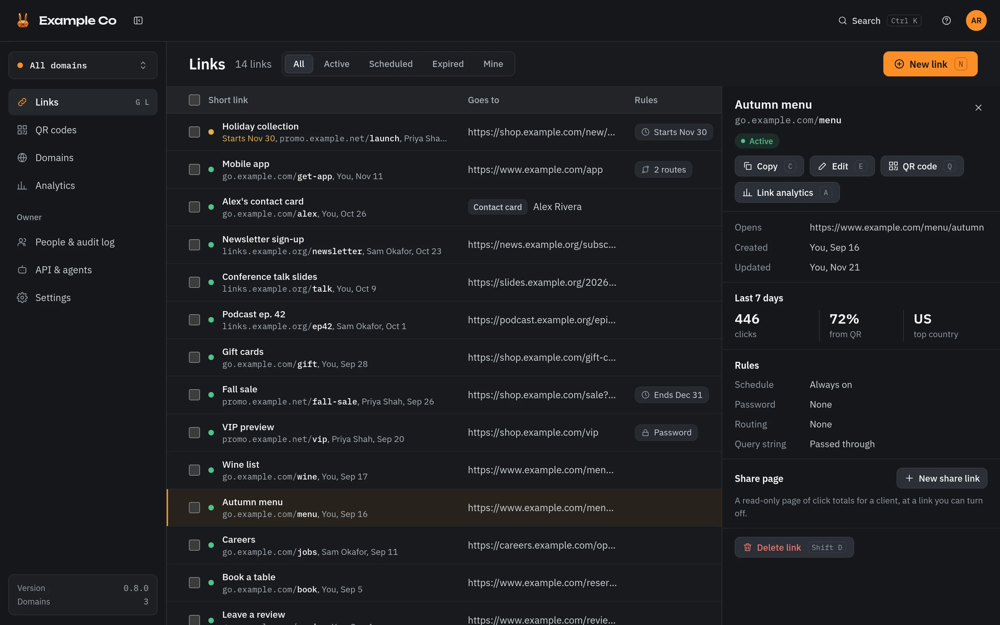
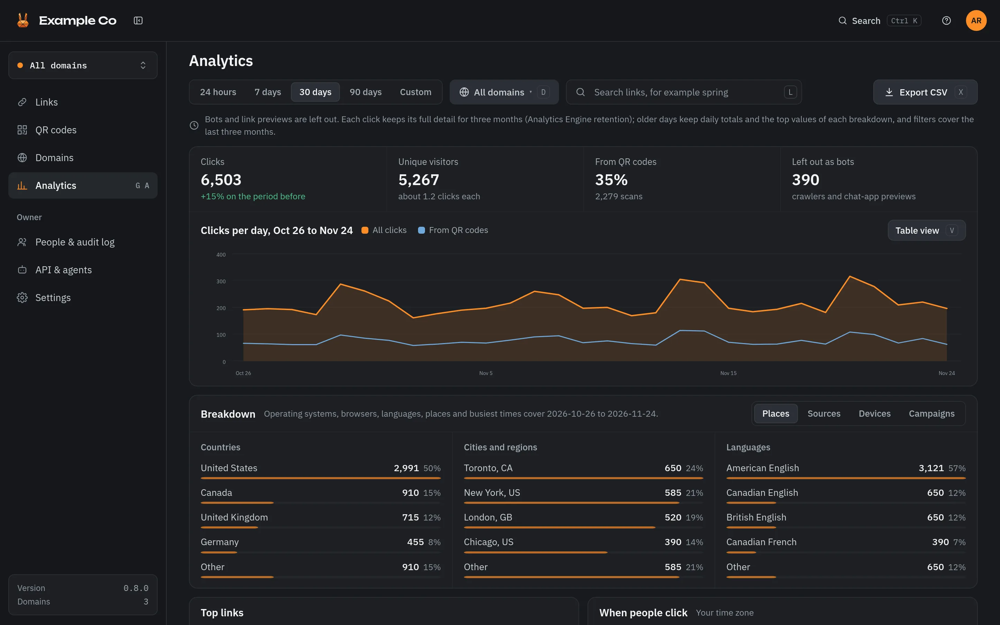
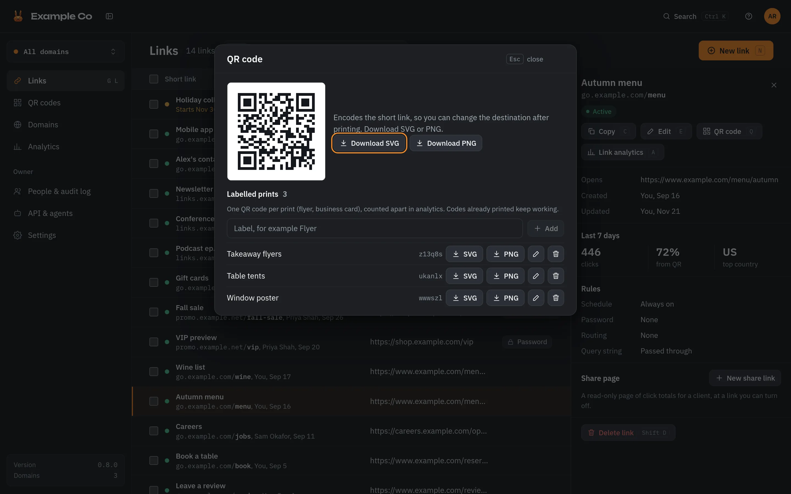

# linkwarren

Short links on every domain you own, in your own Cloudflare account.

linkwarren is a self-hosted link shortener for people with more than one domain. One install serves short links on as many domains as you like, and each domain keeps its own slugs, so `a.example.com/menu` and `b.example.org/menu` can go to different places. It runs on Cloudflare Workers, D1, KV and Analytics Engine, fits the Workers free plan, and keeps every click on infrastructure you control: no cookies, no scripts on short links, and no third-party tracking. The dashboard works with a keyboard and on a phone, and AI agents can manage links through its built-in MCP server.

- Website and docs: [linkwarren.dev](https://linkwarren.dev) ([getting started](https://linkwarren.dev/docs/getting-started/))
- Latest release: [releases](https://github.com/hodylabs/linkwarren/releases)



<p>
  
  
</p>

## Features

- **Many domains.** Main, shared and private domains, each with its own slugs. With a Cloudflare API token, linkwarren attaches domains in your account itself and connects outside domains with one CNAME (Cloudflare for SaaS).
- **Names and one search.** Give any link an optional name; one search finds links by name, slug or destination.
- **Link rules.** Start and end dates, passwords, routing by country, device or operating system, `301` or `302`, query pass-through, campaign tags, and `tel:` and `mailto:` links.
- **Contact card links.** A short link that downloads a vCard (name, phones, emails, websites, address, note and photo) straight into the phone's contacts.
- **QR codes.** Every link has one, and scans are counted apart from typed visits. Give a link a labelled code per print (flyer, poster, business card) and each is counted on its own. A QR code generator makes codes for Wi-Fi, web addresses, text, email, phone, SMS and short links, with your colors.
- **Safe moves and bulk edit.** Move links between domains and the old address keeps forwarding, so printed codes never break. Delete, schedule, move or protect up to 50 links at once. Deleted slugs stay locked.
- **Analytics.** Clicks over time, QR scans, countries, referrers, devices, operating systems, browsers, languages, cities, UTM campaigns and the busiest hours, with a page per link. Click any row to filter the whole page, watch the last 50 clicks come in, and keep the breakdowns past three months. Bots and link previews are left out.
- **Alerts and share pages.** Opt-in emails when a link goes quiet or spikes, a weekly summary, and a read-only, revocable page of click totals to share with a client.
- **People and roles.** Invites, custom roles, per-person domain access, sign-in with email links, passkeys, Google, GitHub or single sign-on (OIDC), with SSO enforceable per email domain (or Cloudflare Access), and a 3-year audit log.
- **API and MCP.** A REST API with personal keys, and an MCP server so Claude, ChatGPT and other agents act with your permissions and no more.
- **Import and export.** Bring links in from CSV or JSON in the setup wizard, and take a full JSON export at any time.
- **Yours to run.** Your account, your data, your bill. Updates are tagged releases you deploy when you choose; the dashboard tells you when one is out.

## Quick start

You need a Cloudflare account with a domain on it, a [Resend](https://resend.com) account for sign-in emails, and Node.js 23.6 or newer. Between the commands below you create one D1 database and two KV namespaces, fill in `wrangler.instance.jsonc` (the ids, your hosts and `EMAIL_FROM`), turn on Analytics Engine (or remove its line), and set the `OWNER_EMAIL` and `RESEND_API_KEY` secrets. [docs/getting-started.md](docs/getting-started.md) walks through every step.

```sh
git clone https://github.com/hodylabs/linkwarren && cd linkwarren && git checkout v0.9.2
npm ci
cp wrangler.instance.example.jsonc wrangler.instance.jsonc
npx wrangler d1 migrations apply linkwarren --remote -c wrangler.instance.jsonc
npm run build:web && npx wrangler deploy -c wrangler.instance.jsonc
```

Then open your dashboard host, sign in with the owner email, and the setup wizard takes it from there.

## Documentation

- [Getting started](docs/getting-started.md) and [configuration](docs/configuration.md)
- [Links and link rules](docs/links.md), [contact cards](docs/vcards.md), [QR codes](docs/qr-codes.md) and [analytics](docs/analytics.md)
- [People and roles](docs/people-and-roles.md) and [domains](docs/domains.md)
- [Agents and API keys](docs/agents.md), the [API reference](docs/api.md) and the [MCP tools](docs/mcp.md)
- [Deploying](docs/deploy.md), [updating](docs/updating.md), [backups](docs/backup.md), [self-hosting costs](docs/self-hosting-costs.md) and [troubleshooting](docs/troubleshooting.md)
- [Privacy](docs/privacy.md): what is recorded per click, and what never is
- [Local development](docs/development.md) and the [design spec](docs/spec.md)

The same pages are on [linkwarren.dev/docs](https://linkwarren.dev/docs/getting-started/).

## License

linkwarren is open source software, licensed under the GNU Affero General Public License v3.0 (see `LICENSE`).

Copyright (C) 2026 Hody LLC

The name and logo are covered by `TRADEMARK.md`. To contribute, read `CONTRIBUTING.md`.
